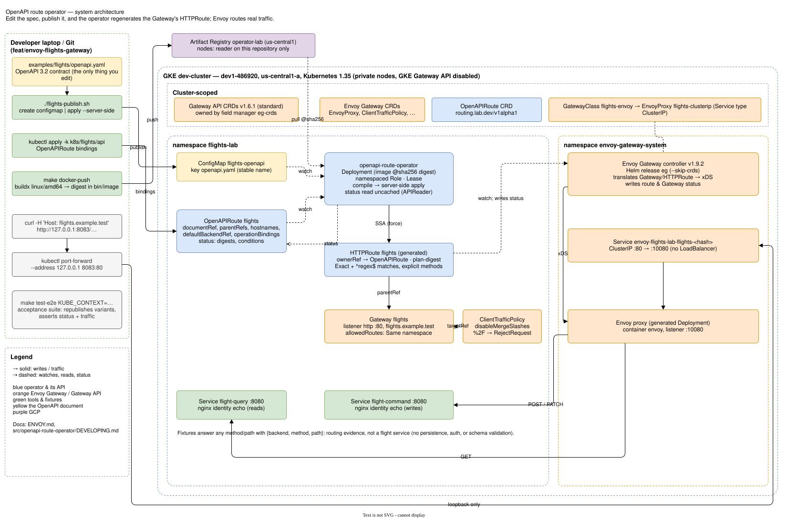
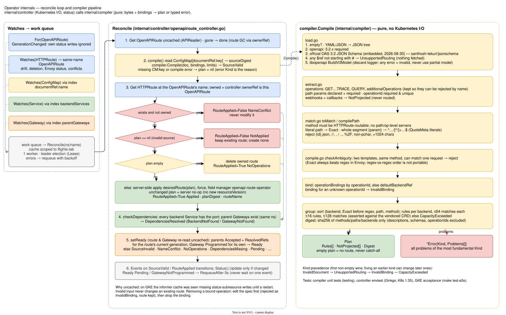

# Developing the OpenAPI route operator

For engineers changing the operator. Using it — the API, status, and safe spec changes — is in
[README.md](README.md). The Envoy Gateway runtime it targets is in [ENVOY.md](../../ENVOY.md); the
exercise's scope and decisions are in [PLAN.md](../../PLAN.md) and
the capability specs in `openspec/specs/` (what the system must do) and the archived change
`openspec/changes/archive/2026-10-22-add-openapi-route-operator/` (`design.md` records every non-obvious choice).

## Architecture





Source: [`docs/architecture.drawio`](docs/architecture.drawio) (two pages; open in draw.io or the VS
Code extension). The SVGs are exports of it: after editing, re-export both pages with
`drawio -x -f svg -p <1|2> --embed-svg-fonts false -b 10 -o docs/architecture-<system|internals>.svg docs/architecture.drawio`.

In one paragraph: a developer edits `examples/flights/openapi.yaml` and publishes it to the
ConfigMap `flights-openapi`. The operator watches that ConfigMap and the `OpenAPIRoute` that points
at it, compiles the document plus the OpenAPIRoute's bindings into a plan, and server-side applies
one `HTTPRoute` it owns. Envoy Gateway turns the route into Envoy config and reports
`Accepted`/`ResolvedRefs` on it; the operator folds that into the OpenAPIRoute's `Ready`.

### The one boundary that matters

| Package | Does | Must not |
| --- | --- | --- |
| `internal/compiler` | bytes + bindings → `Plan` or `*Error{Kind, Problems}`. Pure and deterministic. | import a Kubernetes client, read files, log, or touch the network |
| `internal/controller` | reads inputs, calls the compiler, writes the route and status | contain translation rules |
| `api/v1alpha1` | the `OpenAPIRoute` type and its validation markers | contain logic |

If a change needs both, the rule goes in the compiler and the plumbing in the controller. That
keeps every routing decision unit-testable in milliseconds.

## Layout

| Path | What |
| --- | --- |
| `api/v1alpha1/openapiroute_types.go` | Spec, status, condition types. Markers generate the CRD. |
| `internal/compiler/load.go` | parse, OpenAPI 3.2 version check, official JSON Schema, external `$ref` scan, libopenapi model |
| `internal/compiler/extract.go` | operations (incl. QUERY / additionalOperations), path params, operationIds, webhooks/callbacks |
| `internal/compiler/match.go` | operation → method + `Exact` / anchored regex; path rejections |
| `internal/compiler/compile.go` | `Compile`, bindings, ambiguity, grouping, capacity, digest |
| `internal/compiler/errors.go` | `Kind`s and `*Error` |
| `internal/compiler/schema/` | the embedded OAS 3.2 JSON Schema (2026-08-30) |
| `internal/controller/openapiroute_controller.go` | `Reconcile`, conditions, watches, indexes, RBAC markers |
| `internal/controller/route.go` | plan → HTTPRoute apply configuration |
| `cmd/main.go` | manager: namespaced cache, leader election, flags |
| `config/` | Kustomize: CRD (generated), namespaced RBAC, Deployment. `k8s/operator` builds on `config/default`. |
| `test/crds/gateway-api/` | Gateway API v1.6.1 standard CRDs, copied by `make gateway-api-crds` — do not edit |
| `test/e2e/` | GKE acceptance suite (`//go:build e2e`) |
| `docs/` | architecture diagram |

## Setup

- **Go** per `go.mod` (`go 1.26`; developed with 1.27). **Docker** with buildx, for images.
- Everything else is pinned and downloaded into `bin/` by the Makefile on first use:
  controller-gen v0.22.0, setup-envtest (from controller-runtime v0.25.0), kustomize,
  golangci-lint v2.13.1, and envtest binaries for **Kubernetes 1.35** (the dev cluster's minor;
  `ENVTEST_K8S_VERSION`).
- **Kubebuilder** (v4.16.0) is only needed to scaffold a new API kind or webhook.
- **For cluster work**: `gcloud`, `kubectl`, `helm`, and the context
  `gke_dev1-486920_us-central1-a_dev-cluster` (GKE-OPS.md).

## Inner loop

```sh
make test     # manifests + generate + fmt + vet, then compiler unit tests and envtest (~30 s)
make lint     # golangci-lint (.golangci.yml); must report 0 issues
make build    # bin/manager
```

CI (`.github/workflows/operator-ci.yml`) runs `make manifests generate fmt` and fails on any diff,
then vet, `make test`, and an image build. So: **commit generated files** (CRD, RBAC, DeepCopy,
`test/crds/`) together with the change that produced them.

## Test layers

| Layer | Where | Runs against | Use it for |
| --- | --- | --- | --- |
| Compiler unit | `internal/compiler/*_test.go` (std `testing`) | nothing | every translation rule, rejection, ordering, digest, capacity. Fixtures in `testdata/`; the flights contract is read in place from `examples/`. |
| Controller envtest | `internal/controller/*_test.go` (Ginkgo) | a real kube-apiserver + etcd (1.35), the real manager running | reconcile behavior: ownership, preservation, drift, status, watches, leader election, restart |
| GKE acceptance | `test/e2e/` (Ginkgo, `-tags e2e`) | the live exercise | real Envoy behavior and real traffic; anything envtest cannot do |

envtest has **no garbage collector and no Gateway controller**. Tests check ownerReferences
instead of deletion, and write HTTPRoute/Gateway status themselves (`acceptRoute`,
`programGateway`) where readiness matters. Status written by a real Gateway controller, cache
behavior under its writes, and Envoy's path handling only show up in the acceptance suite —
that is where the stale-status bug below was found.

```sh
make test-e2e KUBE_CONTEXT=gke_dev1-486920_us-central1-a_dev-cluster   # ~50 s, restores the baseline
```

On failure it writes `test/e2e/artifacts/<spec>/` (route/OpenAPIRoute YAML with status, Gateway,
ConfigMap, events, operator and Envoy Gateway logs). README.md (repo root) has the full coverage
table.

## Making changes

### A new compiler rule or rejection

1. Put it in the stage that owns it (`load` / `extract` / `match` / `compile`).
2. Report problems through the `problems` collector with the right `Kind`:
   `InvalidDocument` (not valid OpenAPI 3.2), `UnsupportedRouting` (valid but not representable
   exactly), `InvalidBinding`, `CapacityExceeded`. Report **all** problems of a kind, not the first.
   Never drop or broaden a match to make something fit.
3. Unit tests for the accepted and the rejected case; a fixture in `testdata/` if it is a document
   shape. If it changes routing, the digest test tells you whether it also changes `planDigest`.
4. Update the "What gets routed" table in README.md. If Envoy behavior is involved, add a
   negative-traffic entry to `test/e2e` and a row to ENVOY.md "Envoy behaviors the operator relies on".

### An API (`OpenAPIRoute`) change

1. Edit `api/v1alpha1/openapiroute_types.go`; validate with markers (`+kubebuilder:validation:…`)
   rather than in the reconciler where you can.
2. `make manifests generate`, commit the regenerated CRD.
3. Map it in `internal/controller/route.go` (`compilerInput` / `desiredRoute`).
4. Update `config/samples/`, `k8s/flights/api/openapiroute.yaml`, README.md's API table, and the
   envtest validation cases.
5. Roll out the CRD before the operator that needs it (`kubectl apply -k k8s/operator` does both
   in one apply; for a field removal, migrate existing objects first).

### A new condition or reason

Constants live in `api/v1alpha1` (types) and `internal/controller` (reasons). Add it to README.md's
condition table. If Ready only waits on another controller in the new state, include it in
`waitingOnGateway` so it requeues; if it needs a human fix, it must **not** requeue.

### Watching another kind

Add a field index in `SetupWithManager`, a `Watches(...)` that maps through it, and an RBAC marker
**with `namespace=flights-lab`** (the Role is namespaced; there is no ClusterRole). `make manifests`
and check `config/rbac/role.yaml`. The envtest "generates a namespaced Role without Secret access"
spec guards the result.

### Upgrading Gateway API / Envoy Gateway

Follow ENVOY.md "Upgrading": Envoy Gateway pin, `go.mod` Gateway API version, `make manifests`
(re-copies CRDs), `make test` (the limits test fails if HTTPRoute limits moved), install, `make test-e2e`.

## Running against the dev cluster

```sh
K=gke_dev1-486920_us-central1-a_dev-cluster
kubectl --context $K -n flights-lab scale deployment openapi-route-operator-controller-manager --replicas=0
make install KUBE_CONTEXT=$K      # CRD
make run KUBE_CONTEXT=$K          # local manager; takes the same lease as the Deployment
# ... edit, Ctrl-C, make run again ...
kubectl --context $K -n flights-lab scale deployment openapi-route-operator-controller-manager --replicas=1
```

All instances share the lease `flights-lab/openapi-route-operator`, so a local run waits while
the Deployment holds it. A Ctrl-C releases it; a killed process leaves it to expire (~15 s).

## Releasing a new operator image

```sh
git commit ...                                   # tag = git describe; uncommitted builds get -dirty
make docker-push                                 # linux/amd64, pushes, writes bin/image (repo@sha256:…)
cd ../../k8s/operator && ../../src/openapi-route-operator/bin/kustomize edit set image \
  controller=$(cat ../../src/openapi-route-operator/bin/image)
kubectl --context $K apply -k .
kubectl --context $K -n flights-lab rollout status deployment/openapi-route-operator-controller-manager
cd ../../src/openapi-route-operator && make test-e2e KUBE_CONTEXT=$K
git commit k8s/operator/kustomization.yaml       # the digest pin is part of the release
```

Deployments always reference the **digest**. Nodes pull through a repository-scoped reader grant;
there is no pull Secret. `.dockerignore` is an allow-list: a new non-Go file the binary needs
(like the embedded schema) must be re-included there or the image build fails.

## Debugging

1. `kubectl -n flights-lab get openapiroute flights -o yaml` — read the conditions in order:
   `SourceValid` (did it compile? the reason is the error Kind, the message lists every problem),
   `RouteApplied` (was the route written, or kept/blocked and why), `DependenciesResolved`,
   `Ready`. Compare `status.sourceDigest` with the sha256 `flights-publish.sh` printed.
2. `kubectl -n flights-lab get events --field-selector involvedObject.kind=OpenAPIRoute` —
   one event per SourceValid/RouteApplied transition.
3. Operator logs: `kubectl -n flights-lab logs deploy/openapi-route-operator-controller-manager`.
   Reconciles are quiet on success; errors appear as `Reconciler error`.
4. The generated route's `status.parents` is Envoy Gateway's verdict; ENVOY.md "Troubleshooting".
5. Traffic: port-forward and curl with `Host: flights.example.test`; fixtures echo
   `{backend, method, path}`.

## Invariants — do not break

- **Compile fully before writing.** No partial plans; one unsupported operation fails the document.
- **Invalid input never changes an existing route**, and never creates one.
- **Never modify a route the OpenAPIRoute does not control** (name conflict → condition, no write).
- **An empty plan deletes the route**; there is never a catch-all.
- **Writes are server-side apply** with field manager `openapi-route-operator` and force; an
  unchanged plan is a server no-op, so there is no separate "skip write" logic to keep in sync.
- **Status-bearing reads are uncached** (the OpenAPIRoute at the start of Reconcile, the route
  and Gateway in `setReady`), and waiting on the Gateway controller requeues every 5 s.
- **The plan digest covers routing only** (methods, paths, backends). Description, schema, and
  operationId edits must not churn the route.
- **Namespaced, minimal RBAC.** No Secrets, no cluster-scoped permissions, no GCP IAM.

## Lessons from the dev cluster

| What happened | Consequence in the code |
| --- | --- |
| On GKE the informer cache missed **status-subresource** writes — Envoy Gateway's on the route and, sometimes, the operator's own — until a restart, leaving `Ready=Pending` for an accepted route. A 5 s requeue alone did not help: each pass re-read the same stale cache, and a correct result equal to the stale cached status was never written. | Status-bearing reads go through `APIReader`; Ready requeues while waiting. Reproduced and verified with a drift-repair stress loop (before: 2–3 of 10 stuck ≥30 s; after: 20/20 within 1 s). |
| Envoy Gateway writes status on **every** route attached to the Gateway, which changes `resourceVersion` of routes the operator never touches. | "Untouched" is asserted via `managedFields`, generation, labels, annotations, ownerRefs — never `resourceVersion`. |
| Reading the route from the cache right after creating it can miss it. | `NotFound` after Apply means "Pending", not an error; the route's own watch event follows. |
| The scaffold's default install created and would own the namespace, bound a namespaced Role with a ClusterRoleBinding, and added cluster-scoped metrics/admin roles. | `config/` trimmed to namespaced resources in `flights-lab`; metrics are off (`--metrics-bind-address` default `0`). |
| The scaffold `.dockerignore` excluded the embedded schema JSON; the image build failed. | It is re-included explicitly. |
| Restarting a manager in-process re-registers the controller name. | envtest uses `SkipNameValidation`. |
| Calling `Reconcile` directly in envtest races the suite's running manager on status updates. | Direct-call tests retry conflicts (as the workqueue would). |

## Conventions

- License header on every Go file (`hack/boilerplate.go.txt`).
- `slices`, not `sort` (depguard). goconst is off for `_test.go` only.
- Comments explain *why*; the code says what.
- Commit messages: imperative subject, body with the reason; `main` stays the generic lab — all
  operator work is on the feature branch.
